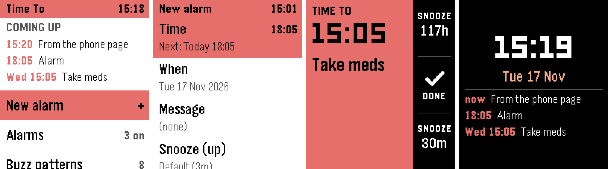
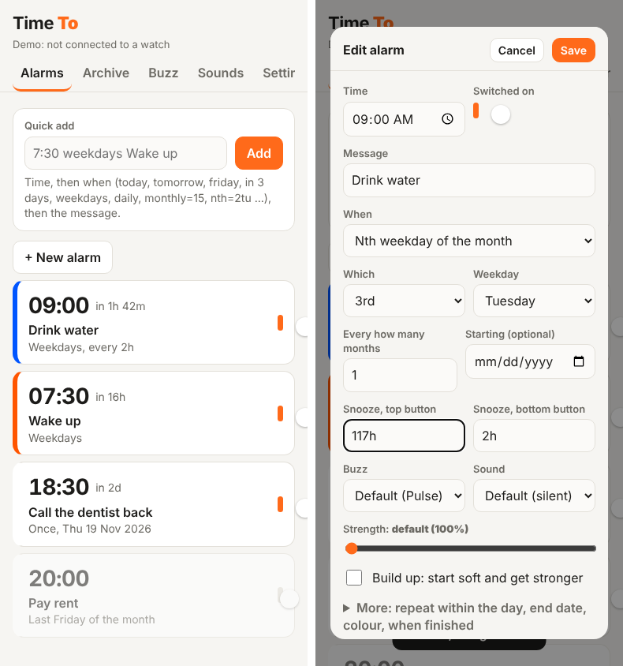

# Time To

Alarms for the Pebble Time 2 that work the way reminders should: each alarm
has its own schedule, its own two snooze lengths, its own buzz, strength and
sound, and a message. Snooze for 3 minutes with one button and 117 hours with
the other if that is what this alarm needs.

Every alarm is one row of CSV, on the watch and off it, so a script, a
spreadsheet or an assistant can make one, and anything you finish can be put
in the archive and brought back later instead of being rebuilt.



## What it does

* **Schedules**: once on a date, in N days, every day or every N days,
  chosen weekdays (every N weeks), a day of the month (or counted from the end),
  the Nth weekday of the month (2nd Tuesday, last Friday), a date every year, a
  day of the year, a start date, a last date, and "ring again every 2 hours
  until 5pm" within a day. Daylight-saving changes are handled.
* **Two snoozes per alarm**: the top and bottom buttons each snooze for their
  own length, anything from a minute to a year. Defaults for both live in
  Settings. Hold either button to pick any other length on the spot.
* **Buzz patterns you compose**: hold the Select button (on the watch) or a
  pad (on the phone) to buzz, let go to pause; the rhythm you tap is the
  pattern. Seven come built in.
* **Strength and build-up**: 10% to 100% per alarm, and an option to start
  soft and get stronger each time it repeats.
* **Sound**: tunes through the Pebble Time 2's speaker, alongside the buzz.
  Make them on the phone with a little piano keyboard, or type notes.
* **Messages**: dictate on the watch, pick a quick phrase, spell it out, or
  type it on the phone.
* **Coming up and agenda views**, plus the usual list with on/off, skip next,
  duplicate, preview, archive and delete.
* **Archive**: finished one-offs move there by themselves (or switch off, or
  delete; your choice, per alarm or by default). Restore one, or use it as a
  template for a new alarm.
* **Unanswered alarms** ring for a minute, snooze themselves, and after five
  tries stop and show as missed (all adjustable).
* **Widgets**: a plugin source that any watchface can read for "the next 3
  alarms", a drop-in C renderer, and an example face. The launcher shows a
  live countdown to the next alarm, and upcoming alarms can go in the timeline.
* **CSV everywhere**: export and import on the phone, `tools/tt.js` for
  scripts, and an `add_alarm` action so other apps and the assistant can set
  alarms.

## Install

You need the Pebble SDK 4.44 or later (`uv tool install pebble-tool`, then
`pebble sdk install latest`).

```bash
pebble build
```

```bash
pebble install --phone <your phone's IP>
```

Or sideload `build/TIME-TO.pbw` from the Pebble app. Open Time To once on the
watch; after that it wakes itself whenever an alarm is due.

## On the watch

| screen | |
| --- | --- |
| Home | "Coming up" (select it for the agenda), New alarm, Alarms, Buzz patterns, Archive, Settings |
| Alarms | every alarm; **select** for its menu, **hold select** to switch it on or off |
| Alarm menu | Turn on/off, Edit, Skip next (or Cancel snooze), Duplicate, Preview, Archive, Delete |
| Editor | Time, When, Message, both snoozes, Buzz, Strength, Build up, Sound, Repeat in day, Last day, Colour, When finished. **Back saves**; "Discard changes" doesn't. |
| Buzz & sound | play patterns and tunes, pick defaults, record a new pattern |

**When an alarm rings:**

| button | does |
| --- | --- |
| Up | snooze for the alarm's first snooze length (hold: choose a length) |
| Select | done |
| Down | snooze for the second snooze length (hold: choose a length) |
| Back | same as Up, so an alarm is never lost by backing out |

## On the phone

Open Time To's settings in the Pebble app. Tabs:

* **Alarms**: quick add (`7:30 weekdays Wake up`, `6:45pm in 3 days Dentist`),
  the list with on/off switches, and the full editor, which shows the alarm's
  CSV row as you edit it.
* **Archive**: restore, use as template, delete.
* **Buzz**: record a pattern on a hold-to-buzz pad, try it on the watch, save.
* **Sounds**: a two-octave keyboard to tap out a tune, play it on the phone,
  try it on the watch, save.
* **Settings**: default snoozes, buzz, strength, sound, volume, how long to
  ring, when to give up, what happens to finished one-offs, timeline pins.
* **CSV**: export alarms, archive, patterns, tunes or settings; import rows
  with per-line error checking; and the column reference.

Changes made while the watch app is closed are queued and delivered the next
time it opens.



## Rows, scripts and agents

See [docs/CSV.md](docs/CSV.md) for the row format, the rule syntax, and a
prompt for turning a voice note into rows. `examples/alarms.csv` has a dozen
real-world examples.

```bash
node tools/tt.js quick "7:30 weekdays Wake up" --snooze-b 117h
node tools/tt.js check examples/alarms.csv
node tools/tt.js next examples/alarms.csv
```

## Widgets

See [docs/WIDGETS.md](docs/WIDGETS.md). In short: subscribe to
`alarms/upcoming` from Time To's plugin in your face's JS, send the rows to the
watch, and draw them with `tt_widget_draw()`. `examples/face` does all of it.

## Limits

64 alarms, 64 archived, 16 buzz patterns, 10 tunes. Messages up to 80
characters. A watch app may hold only 8 wakeups at a time, each at least a
minute from the next, so Time To always books the next 8 distinct ring times
and re-books on every launch; alarms that fall in the same minute ring one
after the other.

## Project layout

```
src/c/core/       scheduling rules, dates, CSV rows (plain C, no Pebble needed)
src/c/            storage, scheduler, wakeups, buzz/speaker player, phone sync, launcher glance
src/c/ui/         the screens
src/c/widget/     the drop-in "next alarms" renderer for watchfaces
src/common/       the same rules and rows in JavaScript, for the phone side and tools
src/pkjs/         PebbleKit JS: sync, outbox, timeline pins, settings page bridge
src/plugin/       the plugin: alarms/upcoming, alarms/all, add_alarm, create_reminder
src/config/       the settings page
tools/tt.js       command line: make, check and preview rows
examples/         a sample alarms.csv and a watchface using the widget
tests/            unit tests, and a check that the C and JavaScript agree
```

## Tests

```bash
tests/run.sh
```

Builds the core with sanitizers and runs it in five time zones (including two
daylight-saving switches), cross-checks the JavaScript port against the C on
5,000 random rules and rows, and runs the plugin against a fake phone.

## Status

Built and run in the Pebble Time 2 (emery) emulator: creating and editing
alarms, the 117-hour snooze, ringing from a closed app, auto-snooze, the
agenda, recording a buzz, the settings page adding an alarm to the watch, and
the example face showing alarms through the plugin.

Not yet tried on a real watch:

* **Strength.** The SDK does not yet let an app set the motor's amplitude, so
  for now strength is made by pulsing the motor in short bursts. The firmware
  already has `vibes_enqueue_custom_pattern_with_amplitudes()`; the build
  switches to it by itself once the SDK exports it. How the pulsing feels on
  the real motor still needs a check.
* **Tunes** play through `speaker_play_notes()`; the emulator does not play
  audio, so volume and tone need checking on the watch.
* **Dictation**, **timeline pins** and the **plugin** on a real phone. The plugin
  needs the Pebble app's plugins preview switched on.

## Sound files, next

Tunes cover beeps and melodies. Playing a recorded clip is the next step, and
the pieces are all there: the speaker plays raw 8 kHz, 8-bit PCM
(`speaker_stream_open()`), and the Time 2 gives each app 1 MB of storage in
256-byte values. The plan: the settings page takes a short audio file,
downsamples it to 8 kHz mono in the browser, and sends it in AppMessage-sized
chunks; the watch stores it as numbered 256-byte values under a name, and
`sound` in an alarm row can then name a clip as well as a tune. Two seconds of
sound is about 16 KB.
